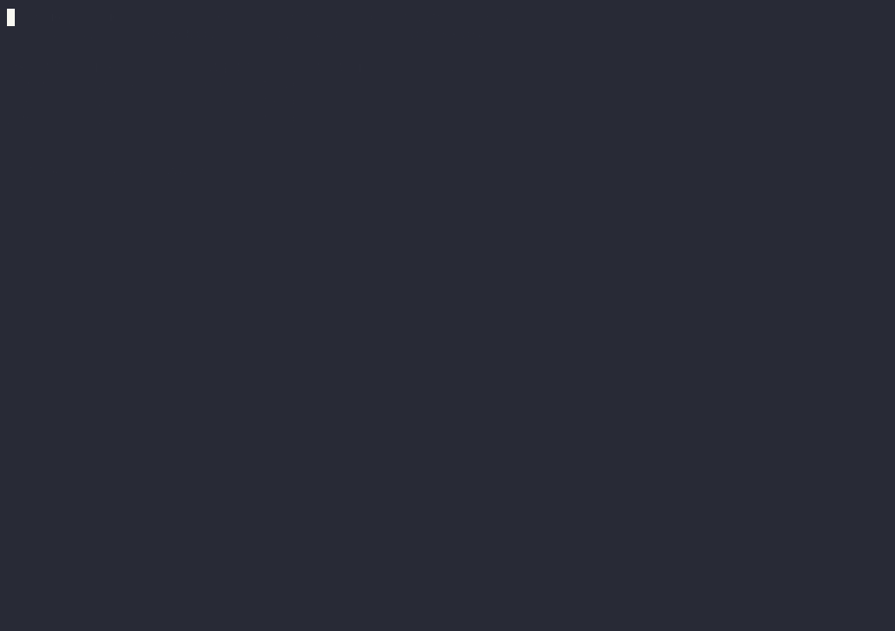

# azzx-crypto-stream



*Demo TUI berjalan — direkam dengan `--demo` (data simulasi, khusus untuk rekaman README; mode normal selalu memakai data live dari exchange).*

Coinglass-lite di terminal: data futures crypto **real-time multi-exchange** (Binance, Bybit, OKX) dalam **satu file binary Go**. Tanpa API key — semua data publik.

## Fitur (v1)

| Tab | Isi |
|-----|-----|
| **Overview** | Harga live + funding rate + open interest per exchange |
| **OrderBook** | 10 bid/ask teratas + bar depth kumulatif (pilih exchange dengan `e`) |
| **Liquidations** | Feed 20 likuidasi terakhir + total 24 jam per exchange |
| **Longs/Shorts** | Bar Long% vs Short% per exchange, timeframe 4h/1d (`f`) |

- Simbol: BTC / ETH / SOL (ganti dengan `s`)
- Tiap exchange independen: kalau satu kena geo-block (mis. Binance 451 dari region tertentu), tampil "unavailable" dan sisanya tetap jalan
- WebSocket auto-reconnect dengan backoff; total likuidasi 24 jam tersimpan di `liqstore.json`

## Build & jalan

Butuh Go 1.21+.

```bash
go build -o azzx-crypto-stream .
./azzx-crypto-stream
```

Tombol: `1-4` pindah tab · `s` ganti simbol · `e` ganti exchange (tab OrderBook) · `f` ganti timeframe (tab Longs/Shorts) · `q` keluar.

Flag tersembunyi `--demo` menjalankan TUI dengan **data simulasi** (khusus untuk rekaman `demo.gif` di README — tidak pernah dipakai untuk keputusan trading):

```bash
./azzx-crypto-stream --demo
```

`demo.gif` direkam ulang dari `demo.tape` dengan [asciinema](https://github.com/asciinema/asciinema) + [agg](https://github.com/asciinema/agg):

```bash
asciinema rec --cols 120 --rows 36 --command "./azzx-crypto-stream --demo" demo.cast
agg --font-size 14 demo.cast demo.gif
```

## Test

```bash
go test ./...
```

## Roadmap

- **v2**: liquidation heatmap (model estimasi — diberi label jujur sebagai estimasi, bukan data exact), alert Telegram (funding melonjak / likuidasi besar)
- **v3**: ETF flows & on-chain flows — *tidak bisa* tanpa data berbayar (disclosure jujur)

## Catatan

Copyright (c) 2026 aziz-sudrajat <azizsudrajat.stb4@gmail.com> — https://github.com/aziz-sudrajat
